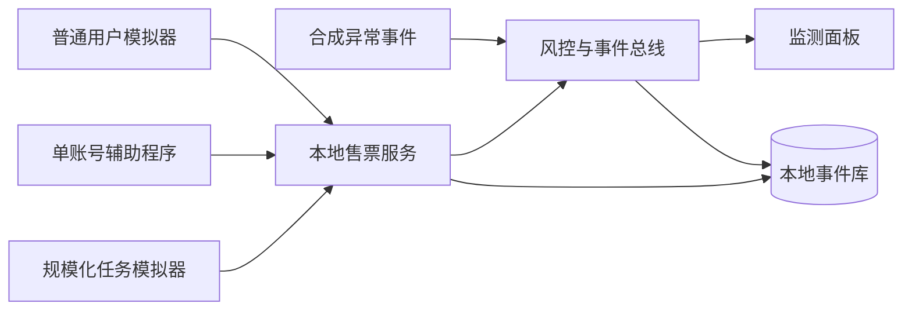

# 本地抢票与反制仿真 Demo：方案设计

**版本：**v1.0 · 2026-11-16  
**定位：**在本机复现演出票开售、自动化下单与防护决策，用于理解和评估反制策略。  
**关联文档：**`docs/research/2026-11-16-scalping-ecosystem-survey.md`

## 1. 设计依据与边界

进一步核对五个 GitHub 仓库的 README，可归纳出四种值得复现的行为：①开售时间触发；②票档/观演人预选与自动提交；③余票出现后的持续监控和重试；④多任务并行。[G1]–[G5] 其中 [G1] 当前公开说明支持猫眼的卡点与余票监控，大麦只是计划中的通知能力；[G2] 主推安卓移动端，其 Desktop 路线自述已不可用；[G3] 对猫眼和大麦使用安卓控制，其 HTTP API 直连针对的是票星球。不能把作者描述中的时间精度、成功率当作已验证结果。

Demo 使用**完全自建的虚构售票服务和虚构演出**。票档、观演人、订单、验证码、风险分均为模拟数据。它应忠实呈现软件在本地的工作流和行为信号，但不接入大麦、猫眼、闲鱼或淘宝，也不复刻任何真实平台接口、签名、验证绕过方法。这是为了让对照实验可重复，并让实验结论可归因。

## 2. 要回答的问题

1. 自动化客户端相对普通用户，优势来自预填信息、定时触发、重复尝试还是并发规模？
2. 当库存有限且有多个购票者时，排队、限速、实名校验各自改变了什么？
3. 哪些日志能区分普通快速用户、单账号辅助程序与规模化抢票？
4. 防护策略会误伤多少普通用户，最终票是否真正进入其实名订单？

**不把“先提交请求者必胜”当作唯一规则。**实验至少有“直接竞争”和“排队分配”两种售卖模式，以免结论被单一分配机制决定。

## 3. 用户看到的 Demo

建议做成一个本地 Web 应用，打开后有三个并列页面：

| 页面 | 主要操作 | 主要展示 |
|---|---|---|
| 售票台 | 创建虚构演出、设定开售倒计时、票档和库存；手动扮演普通买家 | 开售状态、排队号、锁票/支付模拟、剩余库存 |
| 抢票客户端 | 选择单账号自动化或多账号压力场景；设定目标票档、预填观演人、启动/暂停 | 状态机：待命→等待开售→发现票档→提交→锁票/失败→重试→完成 |
| 监测台 | 开关限速、排队、单证件限购、行为关联；重置并重跑同一种子 | 时间线、请求量、各群体购票结果、拦截与误伤、库存流向 |

首页附一键示例：**20 张票、80 名普通用户、5 个单账号辅助程序、1 组 20 账号的规模化任务**。数字只是可编辑的演示参数，不是现实比例估计。

## 4. 核心仿真规则

### 4.1 票务流程

`预热/浏览 → 开售 → 选择票档 → 请求锁票 → 订单确认 → 模拟支付/超时释放 → 完成或退票回流`。

- 每场演出有多个票档，库存只在服务器权威状态中更新。锁票应原子化，不能超卖；锁定超时自动释放。
- 每个虚构证件号每场最多一票，购票者与观演人绑定；此规则对应大型营业性演出实名购票、实名入场要求。[P1]
- 模拟支付用本地按钮或概率事件，不接真实支付服务。余票回流可触发监控型客户端。
- 所有流程使用统一虚拟时钟；可选 1×、10× 加速。固定随机种子后重跑应得到相同结果。

### 4.2 三类客户端

| 类型 | 行为 | 仿真价值 |
|---|---|---|
| 普通用户 | 浏览、阅读、手动选票，操作间隔带随机波动；可能误点或放弃 | 建立对照组与误伤基线 |
| 单账号辅助程序 | 预填选项，在开售或余票出现时按预定流程操作；失败后有限重试 | 对应公开仓库中的卡点、选票和余票监控模式 [G1][G2][G4][G5] |
| 规模化任务 | 多个虚构账号/设备并行执行相同目标，集中锁票 | 对应检察机关披露的批量设备/账号风险，而非对某个开源仓库的指控 [S2][S3] |

每种客户端只调用本地售票服务提供的正常接口。为了分析“异常绕过”与普通自动化的差异，可以额外设一个**抽象异常流量注入器**：注入“缺少前序步骤但请求下单”的合成事件，供监测台检验流程一致性；它不含真实平台参数、签名或绕过逻辑。

### 4.3 可切换防护

| 开关 | 最小实现 | 预期可比较的结果 |
|---|---|---|
| 单账号/设备节流 | 滑动时间窗限制请求与锁票频率，超过后延迟或拒绝 | 异常重试量、普通用户受影响率 |
| 排队分配 | 开售前进入候场，开售时分配队列位置，再按位置放行 | 把毫秒级竞争变为可解释的分配过程 |
| 实名限购 | 单虚构证件号单场限购，订单与观演人一致 | 重复占票比例与实际独立观演人数 |
| 行为关联 | 依据账号、设备、网络与观演人之间的模拟关联计分 | 规模化任务识别率、共享设备家庭用户误伤率 |
| 流程一致性 | 锁票时核验有效会话、票档选择、前序状态 | 合成异常事件检出率 |

每个开关要能显示**触发原因**，并保留正常用户申诉/复核路径。阈值默认值只用于演示，不能从 Demo 直接迁移到生产。

## 5. 系统结构与数据

**建议技术栈：**TypeScript + React/Vite（界面）、Node.js + Fastify（本地服务）、SQLite（事件和运行结果）。单机运行、无需云服务；可用一个启动命令打开服务与界面。选择这些组件是为了开发量小、界面实时反馈容易、事件可回放；不依赖安卓真机或浏览器自动化驱动。

**主要实体：**`Scenario`（随机种子、人数、开售时间）、`Event`（演出/场次/票档）、`Inventory`（可售、锁定、已售）、`Actor`（普通/辅助/规模化）、`Identity`（虚构观演人）、`Session`（设备与网络标识）、`Attempt`（选择/锁票/失败）、`Order`（锁定/支付/释放）、`RiskDecision`（规则、分值、处置）。

**事件日志最少字段：**运行 ID、虚拟时间、客户端类型、账号/设备/网络匿名 ID、演出和票档、动作、结果、等待时长、触发规则。数据仅为模拟值，导出 CSV/JSON 后可以复核每一张票的去向。

## 6. 指标与实验设计

**主要指标：**正常用户购票成功率、各类客户端获票占比、独立观演人数、请求/锁票/支付转化率、平均等待时间、误拦截率、库存最终状态。报告同时显示各指标的分子与分母，避免只看百分比。

**建议的四组实验：**

1. 基线：只有普通用户，直接竞争。
2. 加入单账号辅助程序：比较预填和定时触发的影响。
3. 加入规模化任务：比较设备/账号关联与批量锁票。
4. 逐个打开防护，再组合防护：保持相同人数、库存和随机种子，比较收益与误伤。

每组至少重复多个随机种子，展示均值与波动范围；同时保留一个固定种子的“逐秒回放”，用于解释具体订单为何成功或失败。仿真结果只说明**模型内**的相对变化，不是大麦或猫眼的实际统计。

## 7. 实施拆分与验收

| 阶段 | 交付物 | 验收标准 |
|---|---|---|
| A：可玩闭环 | 售票台、手动购票、倒计时、库存/锁票/支付模拟 | 20 张票最多生成 20 张有效已支付订单；超时锁票能回流 |
| B：客户端模拟 | 单账号辅助程序、余票监控、多账号任务、暂停/重置 | 状态变化和每次尝试可在时间线追溯；重置后同种子结果可复现 |
| C：反制面板 | 五项防护开关、规则解释、指标对照 | 可用同一场景比较至少两组运行，并显示正常用户误伤 |
| D：归档 | README、场景配置、结果导出、设计和局限说明 | 离线启动；无真实票务域名、凭据、支付或个人身份资料 |

**最小可用版本建议：**先完成 A+B+C 中的“节流 + 排队 + 实名限购”三个开关。行为关联与合成异常事件作为下一轮扩展。这样第一版就能回答速度优势、规模优势和防护代价三个关键问题。

## 8. 来源

- [P1] [文化和旅游部、公安部：大型营业性演出管理通知](https://zwgk.mct.gov.cn/zfxxgkml/scgl/202309/t20230912_947197.html)。
- [S2] [江苏检察网：镇江代抢团伙案件](https://www.jsjc.gov.cn/yaowen/202608/t20260812_1350917.shtml)。
- [S3] [江苏检察网：南通“手机墙”案件](https://www.jsjc.gov.cn/yaowen/202604/t20260407_1320570.shtml)。
- [G1] [Pactum7/ticket-grabbing](https://github.com/Pactum7/ticket-grabbing)。
- [G2] [yanzilee/damaiTickets](https://github.com/yanzilee/damaiTickets)。
- [G3] [TsungShr/ticket-sniper](https://github.com/TsungShr/ticket-sniper)。
- [G4] [chl-5g/damai-ticket](https://github.com/chl-5g/damai-ticket)。
- [G5] [LiLeo505/ticket-puchase](https://github.com/LiLeo505/ticket-puchase)。

**证据限制：**仓库功能为作者自述，本方案未运行这些项目；案件报道涉及具体案件和阶段，不推定所有代抢都采用相同技术。
